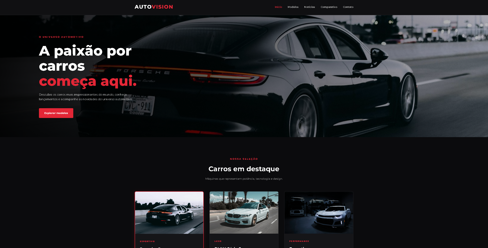
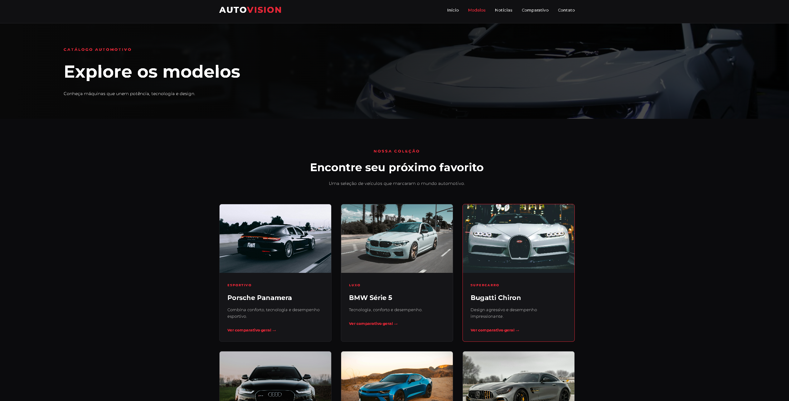
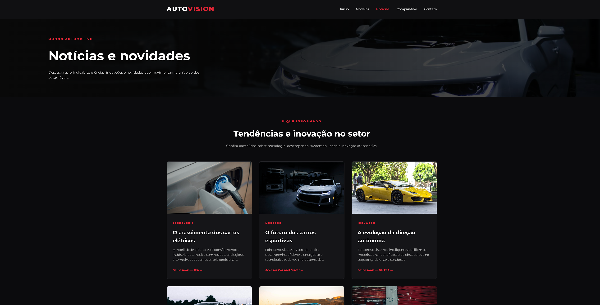
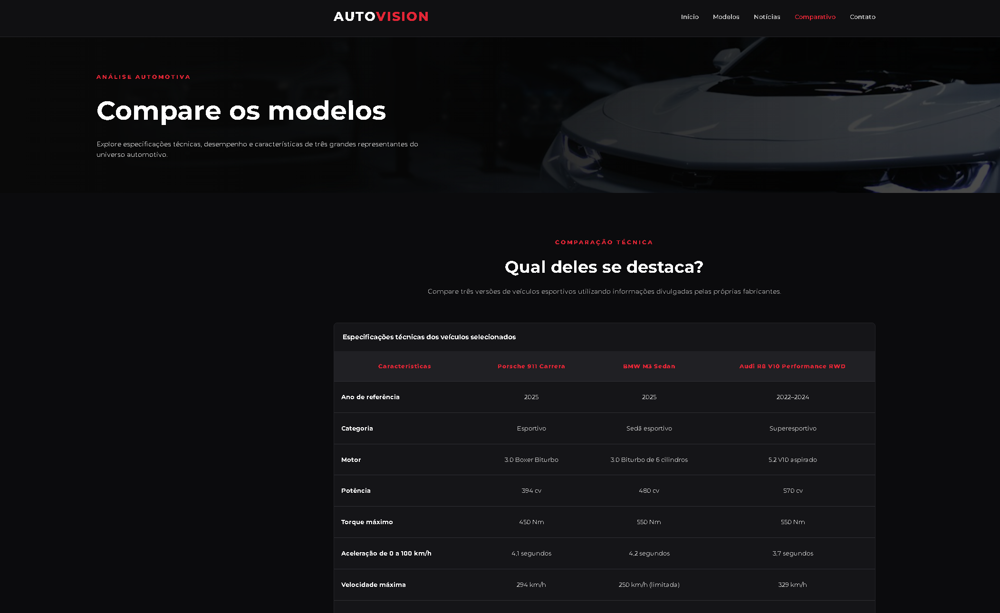
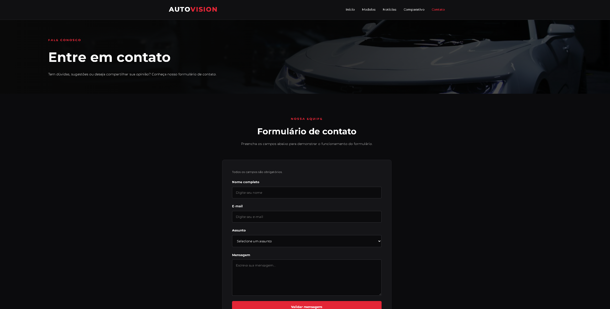
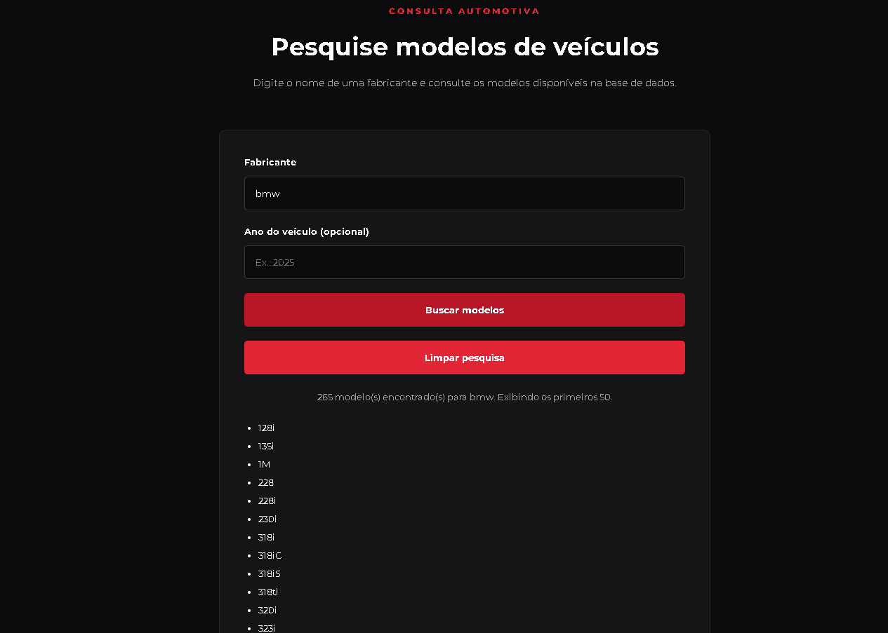
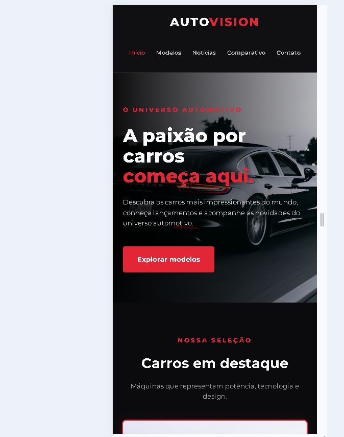
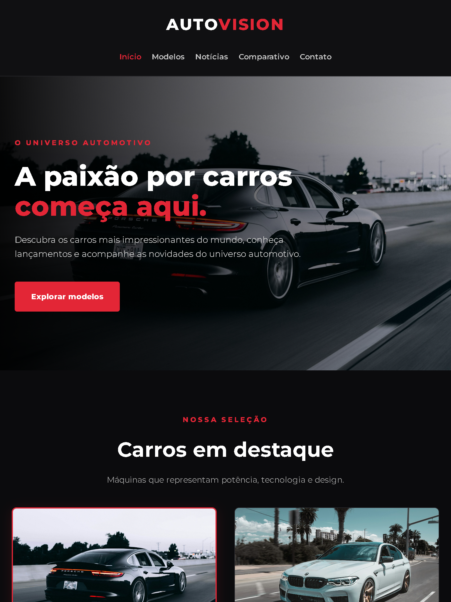

# AUTOVISION

> Tecnologia, desempenho e paixão pelo universo automotivo.

Projeto acadêmico desenvolvido para a disciplina de Web Coding,
com aplicação prática de HTML5, CSS3, JavaScript e integração
com uma API externa.

## Integrantes

| Integrante | GitHub |
|---|---|
| Nicolas Sá Soares | [nicosasoares-cpu](https://github.com/nicosasoares-cpu) |
| Guilherme Rodrigues Silva Galvão | [guilheme3006-ux](https://github.com/guilheme3006-ux) |

## Sobre o projeto

O AutoVision é um site informativo voltado ao universo automotivo,
apresentando veículos esportivos, automóveis de luxo, notícias,
comparações técnicas e pesquisa dinâmica de modelos.

O projeto busca proporcionar uma experiência de navegação
moderna, responsiva, acessível e intuitiva.

## Objetivos

- Desenvolver um website com cinco páginas interligadas.
- Aplicar os princípios do HTML5 semântico.
- Utilizar CSS externo e metodologia BEM.
- Implementar layouts com Flexbox e CSS Grid.
- Adaptar a interface para diferentes dispositivos.
- Desenvolver funcionalidades interativas com JavaScript.
- Consumir dados de uma API pública.
- Utilizar Git e GitHub para versionamento colaborativo.

## Páginas do site

| Página | Funcionalidade |
|---|---|
| [Início](index.html) | Apresentação, destaques e categorias automotivas |
| [Modelos](pages/modelos.html) | Catálogo de veículos e pesquisa pela API |
| [Notícias](pages/noticias.html) | Conteúdos, tecnologia e informações automotivas |
| [Comparativo](pages/comparativo.html) | Comparação de especificações técnicas |
| [Contato](pages/contato.html) | Formulário demonstrativo com validação |

## Tecnologias utilizadas

- HTML5
- CSS3
- JavaScript
- CSS Flexbox
- CSS Grid
- Media Queries
- Metodologia BEM
- API REST
- Fetch API
- Git
- GitHub
- Visual Studio Code

## Estrutura do projeto

```text
autovision-web/
|
|-- index.html
|
|-- pages/
|   |-- modelos.html
|   |-- noticias.html
|   |-- comparativo.html
|   |-- contato.html
|
|-- css/
|   |-- style.css
|
|-- js/
|   |-- script.js
|
|-- images/
|   |-- veiculos/
|   |-- noticias/
|
|-- docs/
|-- screenshots/
|
|-- README.md
```

## HTML5 semântico

O projeto utiliza elementos semânticos para melhorar a
organização, a acessibilidade e a compreensão do conteúdo.

Principais elementos utilizados:

- header
- nav
- main
- section
- article
- footer
- form
- table

As páginas possuem títulos hierarquizados, textos alternativos
nas imagens e identificação dos elementos de navegação.

## Metodologia BEM

A metodologia BEM (Block, Element, Modifier) foi utilizada
para organizar as classes CSS e facilitar a manutenção.

| Tipo | Exemplo | Finalidade |
|---|---|---|
| Block | `.card` | Componente independente |
| Element | `.card__title` | Elemento pertencente ao componente |
| Modifier | `.card--destaque` | Variação visual do componente |

Outros exemplos:

```css
.header__container
.nav__list
.nav__link--active
.card__description
.categories__item
.comparison__table
.contact__form
.api-search__button
```

## Aplicação de Flexbox

O Flexbox foi utilizado em diferentes áreas do website.

### 1. Cabeçalho

Seletor: `.header__container`

Organiza a identidade visual e o menu de navegação.

### 2. Categorias automotivas

Seletor: `.categories__list`

Distribui os cartões de categorias e permite a quebra
automática de linha em telas menores.

### 3. Seção institucional

Seletor: `.about`

Centraliza e organiza os elementos informativos.

Principais propriedades aplicadas:

```css
display: flex;
flex-direction: row;
justify-content: center;
align-items: center;
flex-wrap: wrap;
gap: 25px;
```

Os valores variam conforme a necessidade de cada seção.

## Aplicação de CSS Grid

O CSS Grid foi utilizado em duas áreas distintas.

### 1. Veículos em destaque

Seletor: `.featured__grid`

Organiza os cartões em colunas responsivas.

```css
display: grid;
grid-template-columns: repeat(3, minmax(0, 1fr));
gap: 30px;
```

### 2. Catálogo de veículos

Seletor: `.models__grid`

Utiliza seis áreas nomeadas para organizar os veículos.

```css
grid-template-areas:
    "carro1 carro2 carro3"
    "carro4 carro5 carro6";
```

O posicionamento dos cartões é definido por `grid-area`,
com adaptações para tablets e celulares.

## Responsividade

O website utiliza Media Queries para adaptar seus componentes
a diferentes dimensões de tela.

| Dispositivo | Configuração | Colunas do catálogo |
|---|---|---|
| Computador | A partir de 769px | 3 |
| Tablet | Até 768px | 2 |
| Celular | Até 480px | 1 |

Resoluções de referência para os testes:

- 375px
- 768px
- 1366px

A responsividade contempla:

- Menu de navegação.
- Imagens.
- Cartões.
- Formulários.
- Títulos e espaçamentos.
- Tabela comparativa.
- Seções organizadas com Flexbox e CSS Grid.

## API automotiva

O projeto utiliza a API pública vPIC, disponibilizada pela
National Highway Traffic Safety Administration (NHTSA).

Documentação:

https://vpic.nhtsa.dot.gov/api/

### Funcionalidades da integração

- Pesquisa por fabricante.
- Filtro opcional por ano-modelo.
- Consulta assíncrona com Fetch API.
- Tratamento de falhas de conexão.
- Limite de tempo para requisições.
- Indicador de carregamento.
- Remoção de resultados duplicados.
- Ordenação alfabética.
- Limpeza dos resultados.

### Endpoints utilizados

Consulta por fabricante:

```text
GetModelsForMake/{fabricante}
```

Consulta por fabricante e ano:

```text
GetModelsForMakeYear/make/{fabricante}/modelyear/{ano}
```

A disponibilidade dos modelos depende dos registros presentes
na base de dados da API.

## Formulário de contato

O formulário utiliza HTML e JavaScript para validar os
dados informados pelo usuário.

São verificados:

- Nome.
- E-mail.
- Assunto.
- Mensagem.

O formulário possui finalidade acadêmica e demonstrativa.
Não realiza envio real de mensagens, armazenamento em banco
de dados ou transmissão para um servidor de e-mail.

## Acessibilidade

O projeto contempla recursos como:

- HTML semântico.
- Textos alternativos nas imagens.
- Identificação dos campos dos formulários.
- Navegação por teclado.
- Estados de foco visíveis.
- Mensagens de retorno das interações.
- Cabeçalhos semânticos na tabela comparativa.

## Controle de versão

O desenvolvimento foi realizado de maneira colaborativa,
utilizando Git e GitHub.

Branches utilizadas:

| Branch | Finalidade |
|---|---|
| main | Versão principal |
| dev/nicolas | Desenvolvimento individual de Nicolas |
| dev/guilherme | Desenvolvimento individual de Guilherme |

As contribuições foram registradas em commits individuais,
com integração por merge para preservar o histórico e a autoria.

## Divisão das contribuições

### Nicolas Sá Soares

- Organização da estrutura do projeto.
- Aprimoramento das páginas HTML.
- Organização dos recursos visuais.
- Metodologia BEM e acessibilidade visual.
- Flexbox responsivo.
- Correções do CSS Grid.
- Revisão da identificação dos veículos.
- Documentação do projeto.

### Guilherme Rodrigues Silva Galvão

- Desenvolvimento inicial do AutoVision.
- Aprimoramento do comparativo de veículos.
- Validação do formulário de contato.
- Aprimoramento da API automotiva.
- Conteúdos informativos e fontes oficiais.
- Revisão da responsividade e acessibilidade.

## Como executar

### 1. Clonar o repositório

```bash
git clone https://github.com/nicosasoares-cpu/autovision-web.git
cd autovision-web
```

### 2. Iniciar um servidor local

No Windows:

```bash
python -m http.server 8080 --bind 127.0.0.1
```

No Linux:

```bash
python3 -m http.server 8080 --bind 127.0.0.1
```

### 3. Acessar pelo navegador

http://localhost:8080/index.html

Também é possível utilizar a extensão Live Server
do Visual Studio Code.

A pesquisa automotiva requer conexão com a internet.


## Website publicado

[Acesse o AutoVision online](https://nicosasoares-cpu.github.io/autovision-web/)

## Capturas de tela

### Página inicial



### Catálogo de veículos



### Notícias automotivas



### Comparativo de veículos



### Formulário de contato



### Consulta pela API automotiva



### Responsividade

| Celular - 375 px | Tablet - 768 px |
|---|---|
|  |  |


## Referências

- [NHTSA vPIC API](https://vpic.nhtsa.dot.gov/api/)
- [MDN Web Docs](https://developer.mozilla.org/)
- [Metodologia BEM](https://getbem.com/)
- [Google Fonts](https://fonts.google.com/)
- [Alternative Fuels Data Center](https://afdc.energy.gov/)
- [Porsche Newsroom](https://newsroom.porsche.com/)
- [BMW Group PressClub](https://www.press.bmwgroup.com/)
- [Audi MediaCenter](https://www.audi-mediacenter.com/)

As imagens e marcas apresentadas pertencem aos respectivos
titulares. Os créditos específicos das fotografias devem
ser consultados na documentação de imagens do projeto.

## Finalidade acadêmica

O AutoVision foi desenvolvido exclusivamente para fins
educacionais, com o objetivo de aplicar conhecimentos
de desenvolvimento web e versionamento colaborativo.

---

**AutoVision — Projeto acadêmico de Web Coding | 2026**
